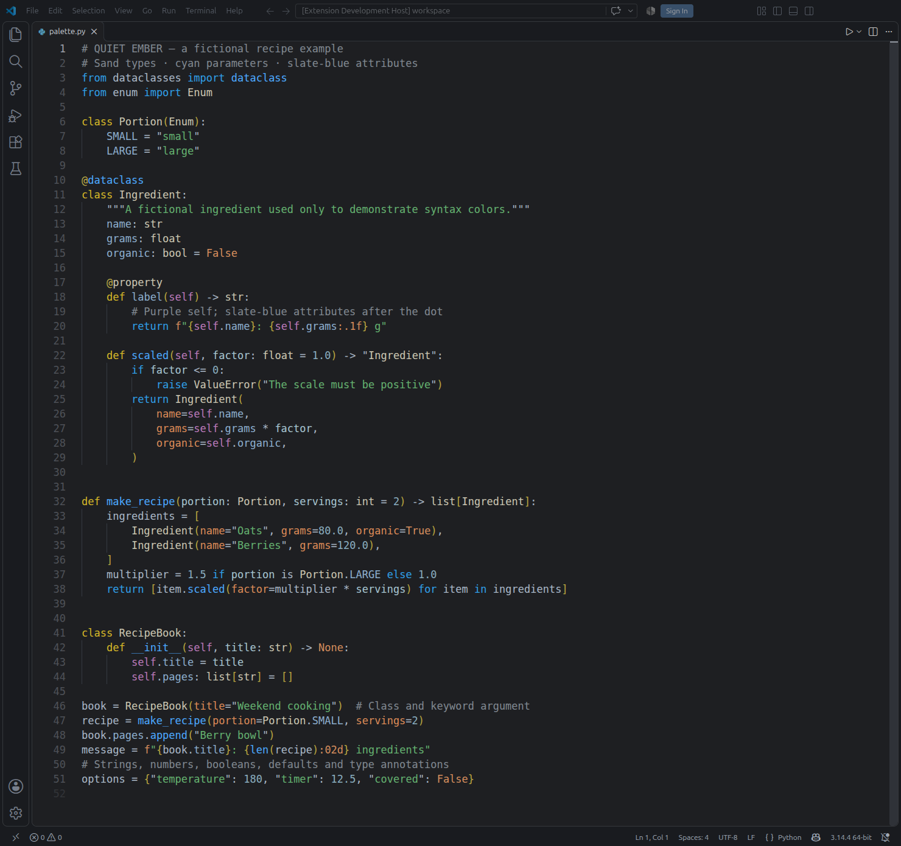

# Quiet Ember Theme

A dark Visual Studio Code theme with warm accents, a charcoal background and clear distinctions between Python syntax categories. Inspired by the restrained feel of JetBrains editors, with its own syntax palette.

## Preview



The preview uses a **fully fictional recipe example written for this theme**. Captured in VS Code with Python and Pylance enabled. Source: [examples/palette.py](examples/palette.py).

## Install

Install **Quiet Ember Theme** from [Visual Studio Marketplace](https://marketplace.visualstudio.com/items?itemName=Toximiner.quiet-ember-theme), then open **Preferences: Color Theme** from the Command Palette and choose **Quiet Ember**.

```sh
code --install-extension Toximiner.quiet-ember-theme
```

You can also download a `.vsix` from [GitHub Releases](https://github.com/Toximiner/quiet-ember-theme/releases) and run **Extensions: Install from VSIX…**.

## Palette

| Category | Color | Example |
| --- | --- | --- |
| Types and classes | Sand | `int`, `str`, `Ingredient`, `Portion` |
| Functions and methods | Blue | `make_recipe`, `scaled` |
| Attributes | Slate blue | `self.grams`, `book.title` |
| `self` and `cls` | Purple | `self`, `cls` |
| Function parameters | Pale cyan | `factor`, `servings` in a definition |
| Keyword argument names | Warm orange | `grams=80.0` |
| Strings | Green | `"Oats"` |
| Comments | Muted gray | `# explanation` |

The theme includes editor, sidebar, tabs, menus, terminal, diff and Git status colors. Brackets use a consistent warm color rather than a rainbow.

## Python highlighting

For the full result shown above, install Microsoft's **Python** and **Pylance** extensions. Semantic highlighting is enabled by the theme. If you explicitly disabled it, set:

```json
"editor.semanticHighlighting.enabled": "configuredByTheme"
```

TextMate grammar colors remain available without Pylance, but the distinction between types, attributes and ordinary variables may be less precise. Other languages use the theme's general syntax rules; their semantic colors depend on the installed language extension. User color customizations can override the palette.

## Development and releases

```sh
npm ci
npm run package
```

The theme contains no executable extension code. GitHub Actions builds the VSIX and attaches it, with a SHA256 checksum, to version-tag releases. Marketplace publishing uses GitHub OIDC Trusted Publishing.

## License

[MIT](LICENSE). This is an independent theme, not affiliated with JetBrains or Microsoft.
